<p align="center">
  
</p>

<p align="center">
  <a href="https://github.com/m3lonxd/nexlite/actions/workflows/check.yml"></a>
  
  <a href="./LICENSE"></a>
  <a href="https://github.com/zen-browser/desktop"></a>
</p>

<p align="center"><b>English</b> · <a href="./README.tr.md">Türkçe</a></p>

NexLite is the official [Zen Browser](https://zen-browser.app) with a small memory layer on top. Nothing is forked or rebuilt. The installer downloads Zen from Zen's own GitHub releases, checks the SHA-256 that GitHub publishes for the file, and adds three plain-text files next to it: tuned default settings and a tab unloader that Zen is currently missing.

With the same {{SITES}} websites open, NexLite **lite** used **{{LITE_IDLE_PCT}}% less memory** than stock Zen once the background tabs had been idle, and **{{LITE_LOADED_PCT}}% less** with every tab loaded. The **max** tier went to **{{MAX_IDLE_PCT}}% less**, at the price of turning off site isolation.

<p align="center">
  
</p>

## Install

```bash
curl -fsSL https://raw.githubusercontent.com/m3lonxd/nexlite/main/install.sh | bash
```

Prefer to read it first? `curl -fsSLO https://raw.githubusercontent.com/m3lonxd/nexlite/main/install.sh`, look through it, then run `bash install.sh`.

NexLite installs into `~/.local/opt/nexlite`, adds a `nexlite` command, a menu entry and an icon. It needs `curl`, `tar`, `xz`, `sha256sum` and `python3`, which almost every Linux desktop already has. No root rights.

| Option | What it does |
| --- | --- |
| `--tier lite` | Default. Saves memory without weakening security. |
| `--tier max` | Saves the most. Turns off site isolation, see [lite or max](#lite-or-max). |
| `--profile DIR` | Start with an existing profile, for example your current Zen profile in `~/.zen`. |
| `--set-default` | Make NexLite the default browser, so links from other apps open in it. |
| `--zen-version TAG` | Install a specific Zen release instead of the latest. |
| `--uninstall` | Remove NexLite. Profiles are kept. |

Run the installer again at any time to update Zen and NexLite; settings and profiles stay. Zen's own updater also keeps working, and NexLite's files survive its updates.

> [!NOTE]
> Using `--profile` with the profile your normal Zen uses? Close Zen first. Two browsers cannot have the same profile open at once.

## Where the memory goes

Zen inherits Firefox's defaults, which assume plenty of RAM. These are the settings NexLite changes, with Zen's value read from the running build.

| Setting | Zen | lite | max | Why it matters |
| --- | --- | --- | --- | --- |
| Tab unloader | does nothing | 10 min | 5 min | Zen 1.24 still registers `zen.tab-unloader.timeout-minutes`. In our test it was set to 1 minute, and after 3 minutes no tab had been unloaded. Idle tabs stay in RAM until the system runs low. |
| `dom.ipc.processCount.webIsolated` | 4 | 1 | 1 | Up to four processes per site. Four YouTube tabs could mean four processes. |
| `dom.ipc.processPrelaunch.enabled` | true | false | false | A spare, empty content process kept running at all times. |
| `browser.tabs.unloadOnLowMemory` | false | true | true | Firefox's own emergency unloader is off on Linux. |
| `browser.low_commit_space_threshold_percent` | 5 | 15 | 25 | When the emergency unloader steps in. At 5% free the system is already swapping. |
| `fission.autostart` (site isolation) | true | true | **false** | One process per site. The biggest single cost, and a real security feature. |
| `dom.ipc.processCount` | 8 | 8 | 4 | Web processes shared by all tabs when site isolation is off. |
| `browser.sessionhistory.max_total_viewers` | auto, up to 8 | 2 | 0 | Whole pages kept alive for instant Back. |
| `image.mem.surfacecache.max_size_kb` | 2 GB | 512 MB | 256 MB | Decoded images kept in RAM. |
| `browser.cache.memory.capacity` | auto, up to 32 MB | 16 MB | 8 MB | In-memory HTTP cache. Pages still use the disk cache. |
| `browser.newtab.preload` | true | false | false | The new-tab page rendered in the background before you open it. |
| `network.prefetch-next`, `network.dns.disablePrefetch` | on | off | off | Pages a site merely hints you might visit next. |

These are installed as *default* values (`browser/defaults/preferences/nexlite-prefs.js`). Anything you change in `about:config` or Settings still wins, and Reset in `about:config` returns to NexLite's value. Every pref is checked against the newest Zen release each week by [`tools/check_prefs.py`](./tools/check_prefs.py), because Firefox silently ignores names it does not know.

## The tab unloader

[`src/nexlite.cfg`](./src/nexlite.cfg) runs once when Zen starts, using Firefox's standard [AutoConfig](https://support.mozilla.org/kb/customizing-firefox-using-autoconfig) mechanism. Every minute (every 30 seconds on max), it unloads background tabs that have not been looked at for the configured time. An unloaded tab keeps its place, title, icon and history; clicking it reloads the page.

It never unloads a tab that is:

- selected, or visible in a split view;
- playing sound, or sharing your camera, microphone or screen;
- in picture-in-picture, still loading, a Glance preview or Zen's empty new-tab placeholder;
- pinned or an Essential, so chat and mail tabs keep their notifications;
- holding unsaved changes. Firefox's own "leave page?" check decides, and NexLite never forces it.

Tune it in `about:config`. Changes apply without a restart.

| Pref | lite | max |
| --- | --- | --- |
| `nexlite.unloader.enabled` | true | true |
| `nexlite.unloader.after-seconds` | 600 | 300 |
| `nexlite.unloader.check-seconds` | 60 | 30 |
| `nexlite.unloader.include-pinned` | false | false |

## lite or max

**lite** keeps every security boundary Zen has. Choose it unless you have a reason not to.

**max** turns off site isolation (Fission). Pages from different sites can share a process again, as in Firefox before version 95. That is where most of the extra saving comes from. It also means a successful exploit, or a Spectre-style attack, in one tab is no longer walled off from other sites' data in the same process. It is a reasonable trade on an old laptop used for reading. It is a bad trade on a machine where you bank and browse unknown sites in the same browser.

## How it is measured

[`bench/measure.py`](./bench/measure.py) unpacks the same Zen archive for every variant and starts it with a fresh profile under Xvfb. It opens the same {{SITES}} real websites: two Wikipedia articles, GitHub, MDN, BBC News, a YouTube channel and Hacker News. It samples at two points:

- **all tabs loaded**: 90 seconds after start;
- **background tabs idle**: 240 seconds after start. To keep a run short, the unloader timer is 2 minutes here instead of 10 or 5.

Memory is the sum of PSS and SwapPss over every browser process. PSS splits shared pages fairly between processes, so shared libraries are not counted twice, and SwapPss keeps swapped-out memory in the total. Each variant ran {{ROUNDS}} times, interleaved, and the chart shows the median. Raw numbers are in [`bench/results.json`](./bench/results.json). Run it yourself:

```bash
python3 bench/measure.py zen.linux-x86_64.tar.xz --rounds 3
python3 tools/render_assets.py      # redraws the banner and chart from the results
```

Your numbers will differ with your sites, extensions and hardware. The direction should not.

## Tests

| Test | What it proves |
| --- | --- |
| [`tests/test_unloader.sh`](./tests/test_unloader.sh) | Starts NexLite with five local pages. Checks that idle tabs are unloaded and that the selected, pinned and unsaved tabs are kept. Checks that the tier's prefs are live in the running browser. |
| [`tests/test_install.sh`](./tests/test_install.sh) | Install, in-place update, tier switch, `--profile`, refusing folders NexLite did not create, uninstall that keeps profiles. |
| [`tools/check_prefs.py`](./tools/check_prefs.py) | Every pref NexLite sets exists in the Zen build. |

CI runs all three on every change and every Monday against the newest Zen release.

## Uninstall

```bash
bash install.sh --uninstall
```

This removes `~/.local/opt/nexlite`, the `nexlite` command, the menu entry and the icon. Browser profiles in `~/.zen` are left alone.

## Legal

NexLite is an independent project. It is not affiliated with or endorsed by the Zen Browser team or Mozilla. "Zen Browser" and "Firefox" are names of their respective owners and are used here only to say what NexLite works with.

NexLite does not redistribute Zen. The installer downloads the unmodified official release from [github.com/zen-browser/desktop](https://github.com/zen-browser/desktop/releases), verifies it and adds NexLite's own files. Zen is licensed under the [MPL-2.0](https://github.com/zen-browser/desktop/blob/dev/LICENSE); NexLite's files are MPL-2.0 too.

This repository used to hold **NexBrowser**, a full fork of Zen. That code is kept in the [`archive/nexbrowser-fork`](https://github.com/m3lonxd/nexlite/tree/archive/nexbrowser-fork) branch.
