<p align="center">
  
</p>

<p align="center">
  <a href="https://github.com/m3lonxd/zen-browser-lite/actions/workflows/check.yml"></a>
  <a href="https://zenbrowserlite.vercel.app"></a>
  
  <a href="./LICENSE"></a>
</p>

<p align="center"><a href="./README.md">English</a> · <b>Türkçe</b></p>

Zen Browser Lite, resmi [Zen Browser](https://zen-browser.app)'ın **resmî olmayan** düşük bellek kurulumudur. Aynı Zen: aynı ad, görünüm, ikon ve güncellemeler. Üstüne küçük bir bellek katmanı eklenir. Hiçbir şey çatallanmaz ya da yeniden derlenmez. Kurulum betiği Zen'i Zen'in kendi GitHub sürümlerinden indirir, GitHub'ın yayımladığı SHA-256 ile doğrular ve yanına üç düz metin dosyası ekler: ayarlanmış varsayılanlar ve Zen'de şu an çalışmayan bir sekme uyutucu.

Testte ikisinde de aynı 7 site açıldı. Arka plan sekmeleri bir süre boşta kalınca varsayılan **lite** katmanı stock Zen'den **%60 daha az bellek** kullandı: 1,20 GB yerine 496 MB. Tüm sekmeler yüklüyken fark %13'tü.

<p align="center">
  
</p>

## Kurulum

```bash
curl -fsSL https://raw.githubusercontent.com/m3lonxd/zen-browser-lite/main/install.sh | bash
```

`~/.local/opt/zen-lite` klasörüne kurulur. `zen-lite` komutunu ve Zen'in kendi ikonunu kullanan bir menü girdisi ekler. Root yetkisi gerekmez. Gerekenler: `curl`, `tar`, `xz`, `sha256sum`, `python3`.

| Seçenek | Ne yapar |
| --- | --- |
| `--tier lite` | Varsayılan. Güvenliği zayıflatmadan bellek kazandırır. |
| `--tier max` | Site izolasyonunu kapatır. Aşağıdaki uyarıyı okuyun. |
| `--profile KLASÖR` | Mevcut bir profille açar, örneğin `~/.zen` içindeki Zen profiliniz. Önce Zen'i kapatın: iki tarayıcı aynı profili aynı anda açamaz. |
| `--set-default` | Varsayılan tarayıcı yapar, diğer uygulamalardaki linkler bunda açılır. |
| `--uninstall` | Kaldırır. Profillere dokunmaz. |

Güncellemek için kurulum betiğini yeniden çalıştırmanız yeterli. Zen'in kendi güncelleyicisi de çalışmaya devam eder.

## Ne değişiyor

- **Sekme uyutucu:** Zen 1.24, `zen.tab-unloader.timeout-minutes` ayarını hâlâ tanımlıyor. Ama testimizde bu ayar 1 dakikaya kuruluyken 3 dakika sonra hiçbir sekme uyutulmamıştı. Zen Browser Lite, kullanılmayan arka plan sekmelerini lite'ta 10, max'te 5 dakika sonra uyutur. Seçili, ses çalan, kamera veya mikrofon paylaşan, sabitlenmiş, Essential ya da kaydedilmemiş değişiklik içeren sekmelere dokunmaz.
- **Süreçler:** site başına en fazla 4 yerine 1 süreç. Önceden açılan boş yedek süreç kapatılır.
- **Bellek azalınca uyutma:** Firefox'un kendi acil durum uyutucusu Linux'ta kapalıdır. Açılır ve %5 yerine %15 boş bellekte devreye girer.
- **Önbellekler:** görsel, HTTP ve geri-ileri önbelleklerine üst sınır konur. Yeni sekme sayfası arka planda önceden yüklenmez, prefetch kapatılır.

Tüm ayarlar *varsayılan* değer olarak kurulur. `about:config` veya Ayarlar'da değiştirdiğiniz her şey geçerli olmaya devam eder. Tam tablo ve gerekçeleri [İngilizce README](./README.md#where-the-memory-goes)'de.

## lite mı max mı

**lite**, Zen'in tüm güvenlik sınırlarını korur. Özel bir nedeniniz yoksa bunu seçin.

**max**, site izolasyonunu (Fission) kapatır. Farklı sitelerin sayfaları yine aynı süreci paylaşabilir. Bu durumda bir sekmedeki istismar veya Spectre tarzı bir saldırı, diğer sitelerin verilerinden yalıtılmış olmaz. Ölçümde max yalnızca tüm sekmeler yüklüyken daha iyiydi: Zen'e göre %20 daha az, lite'ta %13. Sekmeler uyutulduktan sonra lite'tan iyi değildi (−%55'e karşı −%60).

## Teşekkür ve atıf

- **[Zen Browser](https://github.com/zen-browser/desktop)**: Zen ekibi. Bu projenin kurup ayarladığı tarayıcı. MPL-2.0.
- **Zen logosu** (`docs/assets/zen-logo.svg`, `docs/assets/banner.svg` içinde de): Zen ekibi, [zen-browser/branding-archive](https://github.com/zen-browser/branding-archive) deposundan, [CC BY-NC-SA 4.0](https://creativecommons.org/licenses/by-nc-sa/4.0/deed.tr) lisansıyla, değiştirilmeden kullanıldı. Ayrıntı: [`docs/assets/ZEN-LOGO-NOTICE.txt`](./docs/assets/ZEN-LOGO-NOTICE.txt).
- **[Firefox](https://www.mozilla.org/firefox/)**: Mozilla. Zen'in altındaki motor ve sekme uyutucuyu çalıştıran AutoConfig mekanizması.

## Hukuki not

Zen Browser Lite **resmî olmayan**, bağımsız ve ticari olmayan bir projedir. Zen Browser ekibi veya Mozilla ile bağlantısı yoktur ve onlar tarafından onaylanmamıştır. "Zen Browser" ve "Firefox" adları sahiplerine aittir. Bu depo Zen'i yeniden dağıtmaz; kurulum betiği değiştirilmemiş resmi sürümü indirir. Zen ekibi farklı bir ad isterse proje yeniden adlandırılır. Kendi dosyalarımızın lisansı: MPL-2.0.

Bu depoda önceden **NexBrowser** adlı tam bir Zen çatalı vardı. O kod [`archive/nexbrowser-fork`](https://github.com/m3lonxd/zen-browser-lite/tree/archive/nexbrowser-fork) dalında duruyor.
